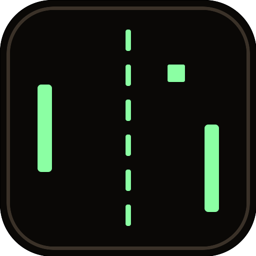

# Pong

The 1972 arcade classic, rebuilt for the browser inside a 1970s walnut-and-CRT
cabinet. Single player against a CPU opponent that tracks the ball like a
person instead of reading its future.



## Features

- Canvas game loop with the original's rough physics: the ball speeds up
  through a rally and resets on every serve.
- A CPU that reacts late, aims with error, and never moves faster than you.
- Three difficulty levels, first to 11 wins.
- 8-bit sound effects synthesized in the browser with the Web Audio API — no
  audio files.
- Keyboard, mouse, and touch controls.
- A CRT cabinet built in CSS: scanlines, phosphor glow, flicker, and a walnut
  woodgrain panel.

## Controls

| Action | Keyboard | Pointer |
| --- | --- | --- |
| Move paddle | `↑` / `↓` or `W` / `S` | Move the mouse or finger |
| Serve | `Space` or `Enter` | Click or tap the screen, or the big round button |
| Start / restart | `START` button | `START` button |
| Difficulty | Buttons `1`, `2`, `3` | Buttons `1`, `2`, `3` |
| Mute | `SND` / `MUT` button | `SND` / `MUT` button |

## Run locally

Requires Node.js 24.

```bash
npm install
npm run dev
```

The app is at <http://localhost:8080>. Set `PORT` to use another port.

## Production

```bash
npm run build   # writes the frontend to dist/
npm start       # serves dist/ and /healthz on 0.0.0.0:$PORT
```

`npm run check` type-checks the project.

## Deploy

The app runs as a single Node process and keeps no state, so it fits Freepod
as-is:

```bash
freepod init --name "Pong" --hostname pong
freepod deploy
```

## Layout

| Path | What |
| --- | --- |
| `src/pages/home.tsx` | The game: physics, CPU, sound, canvas drawing, and cabinet UI |
| `src/index.css` | Tailwind entry point and the cabinet's CRT and hardware styling |
| `src/config.ts` | The app's name |
| `server/index.ts` | One process for the API-free frontend, in development and production |
| `server/same-origin.ts` | Cross-origin write protection and page security headers |
| `public/` | Favicon and app icon |

The game has no backend, database, or stored data. Everything lives in the
browser tab and is gone when it closes.

## License

[MIT](LICENSE)
